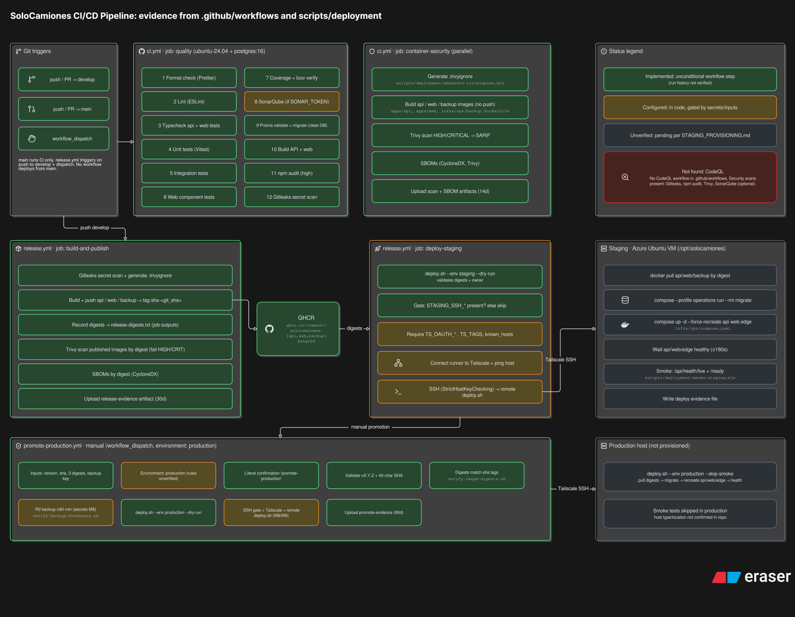

# SoloCamiones — DevOps Architecture & Infrastructure

Technical documentation of the SoloCamiones infrastructure, CI/CD pipelines, security controls, monitoring, and deployment architecture.

The project demonstrates practical DevOps engineering concepts through a containerized business application, GitHub Actions automation, Linux server administration, and cloud infrastructure configuration.

> **Infrastructure status:** The diagrams represent repository-defined architecture and deployment workflows. Some components are implemented, others are configured but not operationally verified, and others remain planned. The diagrams should not be interpreted as proof that every service is currently running.

## 1. Infrastructure Architecture

### Overview

The staging infrastructure is designed around a Microsoft Azure Virtual Machine running Ubuntu Server LTS, with application services orchestrated using Docker Compose.

The architecture is organized into four logical layers:

| Layer                | Components                                      |
| -------------------- | ----------------------------------------------- |
| Edge & Access        | Cloudflare DNS/WAF, Access/WARP, HTTPS          |
| Cloud Infrastructure | Azure VM, NSG, Ubuntu, UFW, Fail2ban, Tailscale |
| Application Services | Nginx, React, Node.js/Express, PostgreSQL       |
| Operations           | Prometheus, Grafana, Vector, exporters, backups |

### Application Architecture

The containerized application includes:

- **Nginx Edge:** Reverse proxy, HTTPS termination and API routing.
- **React Frontend:** Web interface served through Nginx.
- **Node.js / Express API:** Backend business logic and REST endpoints.
- **PostgreSQL 16:** Relational database on an internal container network.
- **Migration Service:** One-shot database migrations.
- **Backup Service:** PostgreSQL database dumps and encrypted backup workflows.

Docker Compose defines the service topology, internal networking, dependencies, and persistent storage.

Relevant configuration:

- `infra/vps/compose.yaml`
- `apps/api/`
- `apps/web/`

### Networking & Security

The architecture includes several layers of security:

**Azure Network Security**

- Azure Network Security Groups (NSG).
- Public HTTP/HTTPS access governed by network rules.
- SSH access designed to operate through the Tailscale network.

**Linux Host Security**

- UFW firewall rules.
- Fail2ban protection.
- SSH key-based authentication.
- Restricted administration through Tailscale.

**Application Security**

- Nginx reverse proxy.
- HTTPS/TLS configuration.
- Cloudflare security and access-control integration.
- PostgreSQL access restricted to internal services.
- Separate database roles based on least-privilege principles.

Cloudflare Access/WARP and certain edge protections are documented as planned in the infrastructure diagram. Their operational status must be verified independently.

## 2. CI/CD Pipeline

### Overview

The continuous integration and deployment processes are defined using GitHub Actions.

The workflows cover code validation, automated testing, security analysis, container image publishing, staging deployment, and controlled production promotion.

### Continuous Integration

The CI workflow is triggered by repository events involving the `develop` and `main` branches.

The pipeline includes:

1. Code formatting verification with Prettier.
2. Static analysis with ESLint.
3. Type checking for API and web applications.
4. Automated testing using Vitest.
5. Integration testing with PostgreSQL 16.
6. Test coverage validation.
7. Prisma schema validation and database migrations.
8. Application builds.
9. Dependency security auditing with npm audit.
10. Secret detection using Gitleaks.
11. Optional SonarQube analysis when configured.

A separate container security job builds application images without publishing them, scans for vulnerabilities with Trivy, and generates CycloneDX Software Bills of Materials (SBOMs).

### Container Build & Registry

The release workflow builds three Docker images:

- `solocamiones-api`
- `solocamiones-web`
- `solocamiones-backup`

Images are published to GitHub Container Registry (GHCR) using commit-based tags.

Immutable SHA-256 image digests are recorded and used by the deployment process to identify exact image versions.

Additional release evidence includes vulnerability scan results and SBOM artifacts.

### Staging Deployment

The staging deployment workflow is designed to:

1. Validate release image digests.
2. Verify required deployment configuration and credentials.
3. Establish connectivity to the target VM through Tailscale.
4. Connect using SSH with host-key verification.
5. Pull container images by immutable digest.
6. Run database migrations.
7. Recreate application containers through Docker Compose.
8. Wait for service health checks.
9. Execute application smoke tests.
10. Record deployment evidence.

Deployment execution is conditional on the required staging secrets and infrastructure availability.

Relevant scripts:

- `scripts/deployment/deploy.sh`
- `scripts/deployment/smoke-staging.mjs`

### Production Promotion

The production promotion workflow is manually triggered through GitHub Actions.

It defines validation steps for release versions, image digests, backup freshness, and deployment configuration.

The intended process reuses validated image digests rather than rebuilding application images.

**Current limitation:** The diagram identifies production infrastructure provisioning and some environment protections as unverified. The production workflow should not be represented as an operational production deployment until validated.

## 3. Monitoring & Observability

The infrastructure diagram includes a monitoring stack designed to provide visibility into application behavior and server health.

### Metrics Collection

| Component           | Responsibility                                   |
| ------------------- | ------------------------------------------------ |
| Prometheus          | Metrics collection, retention and alerting rules |
| Grafana             | Dashboards and metrics visualization             |
| Node Exporter       | Host-level metrics                               |
| PostgreSQL Exporter | Database metrics                                 |
| API `/metrics`      | Application-level metrics                        |

Prometheus is configured to collect metrics from the relevant targets, while Grafana provides visualization through Prometheus queries.

### Centralized Logging

Vector is configured to collect Docker container logs and forward them to an external HTTP logging destination.

Better Stack is identified as a planned external service for centralized logs and uptime monitoring in the infrastructure diagram.

Operational log delivery and alerting require separate verification.

## 4. Backup & Recovery

The architecture includes database backup and recovery components.

### Backup Strategy

The repository-defined backup architecture includes:

- PostgreSQL backups through `pg_dump`.
- Backup encryption using `age`.
- Scheduled backup operations through systemd timers.
- Persistent Docker volumes for database data.
- A dedicated backup service.

### Recovery Validation

An isolated database restore verification component is documented but classified as unverified.

A separate Azure disk snapshot process is shown as planned.

Backup creation, backup freshness, restore testing, and infrastructure snapshots should be validated independently before claiming recovery guarantees.

## 5. Infrastructure Status

The architecture diagrams use the following status definitions:

| Status      | Meaning                                                                                    |
| ----------- | ------------------------------------------------------------------------------------------ |
| Implemented | Implementation exists in repository evidence; runtime success is not necessarily confirmed |
| Configured  | Configuration is present but execution may depend on additional setup                      |
| Planned     | Intended architecture or functionality not yet confirmed as implemented                    |
| Unverified  | Insufficient evidence to confirm operational readiness                                     |

These labels distinguish repository configuration from the actual running environment.

## 6. Technologies

| Category          | Technologies                                            |
| ----------------- | ------------------------------------------------------- |
| Cloud             | Microsoft Azure, Azure VM, NSG                          |
| Operating Systems | Linux, Ubuntu Server                                    |
| Containers        | Docker, Docker Compose, GHCR                            |
| CI/CD             | GitHub Actions, Bash                                    |
| Security          | Cloudflare, Tailscale, UFW, Fail2ban, Gitleaks, Trivy   |
| Web & Backend     | Nginx, React, Node.js, Express                          |
| Database          | PostgreSQL, Prisma                                      |
| Monitoring        | Prometheus, Grafana, Node Exporter, PostgreSQL Exporter |
| Logging           | Vector, Better Stack (planned in diagram)               |
| Quality           | ESLint, Prettier, Vitest, SonarQube (optional)          |
| Backup            | pg_dump, age, systemd timers                            |

## 7. Architecture Scope & Limitations

This documentation focuses on the Azure staging architecture and the repository-defined deployment process.

The following limitations are explicitly represented:

- Production infrastructure is not confirmed as provisioned.
- GHCR publication and selected deployment prerequisites require operational verification.
- Cloudflare edge policies and external monitoring services may differ from their repository-defined state.
- Restore verification and Azure disk snapshots are not confirmed as operational.
- Future integrations and alternative hosting providers are outside the current staging scope.

The architecture should be updated after infrastructure changes, successful deployment validation, or operational testing.

---

**Project:** [SoloCamiones](https://github.com/Solo-Camiones/solocamiones)

**Documentation focus:** Cloud Infrastructure · CI/CD · Containerization · Security · Observability · Backup & Recovery
